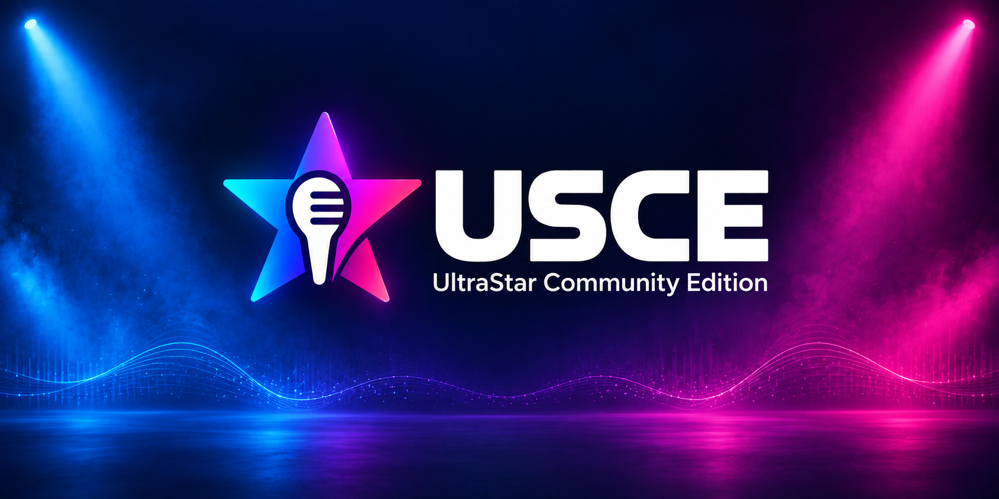

**UltraStar Community Edition** is a free, open-source karaoke game for
Windows, macOS and Linux. Follow the lyrics, match the notes and see how you
score. Sing solo, try a duet or play with up to 24 players.

**[Download USCE](https://github.com/UltraStar-CE/USCE/releases/latest)** ·
[Getting started](https://github.com/UltraStar-CE/USCE/blob/HEAD/docs/getting-started.md) ·
[Themes](https://github.com/UltraStar-CE/Themes)

USCE works with UltraStar-format songs. Song collections are managed separately
from the game.

Share ideas and ask questions in [Discussions](https://github.com/UltraStar-CE/USCE/discussions),
[report a problem](https://github.com/UltraStar-CE/USCE/issues), or
[contribute](https://github.com/UltraStar-CE/USCE/blob/HEAD/CONTRIBUTING.md)
through testing, translations, themes or code.

USCE builds on [UltraStar Deluxe](https://github.com/UltraStar-Deluxe/USDX) and
the original UltraStar by corvus5. Thank you to everyone who has contributed.
