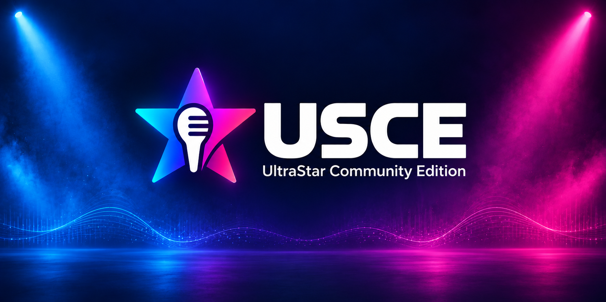

# Sing together. Shape what comes next.

We build **UltraStar Community Edition**, an open-source karaoke game for
Windows, macOS and Linux. Sing along with your music, score points for pitch
and timing, and play together with up to six players.

**[The game](https://github.com/UltraStar-CE/USCE)** ·
**[Ideas and questions](https://github.com/UltraStar-CE/USCE/discussions)** ·
**[Report a bug](https://github.com/UltraStar-CE/USCE/issues)** ·
**[Take part](https://github.com/UltraStar-CE/USCE/blob/HEAD/CONTRIBUTING.md)**

## Get started

We are preparing the first USCE release. Until tested release downloads are
available, contributors can [build from source](https://github.com/UltraStar-CE/USCE/blob/HEAD/COMPILING.md)
or help test our [development builds](https://github.com/UltraStar-CE/USCE/actions).
Songs are managed separately from the game.

## Built by the community

Players, developers, translators, designers and testers all shape USCE. We aim
to move quickly on useful features and community-led experiments, with clear
defaults and configurable options so players can keep the experience they prefer.
We discuss proposals openly and explain our decisions.

Code is only one way to contribute. Testing a build, improving a translation,
creating a theme or explaining a problem can make the game better for everyone.
Our [community conduct](https://github.com/UltraStar-CE/USCE/blob/HEAD/CODE_OF_CONDUCT.md)
and [governance](https://github.com/UltraStar-CE/USCE/blob/HEAD/GOVERNANCE.md)
describe how we work together.

## Our repositories

| Repository | What we develop |
| --- | --- |
| [USCE](https://github.com/UltraStar-CE/USCE) | The karaoke game, releases and community discussions |
| [Themes](https://github.com/UltraStar-CE/Themes) | Themes, skins and artwork |

## Credits

USCE builds on [UltraStar Deluxe](https://github.com/UltraStar-Deluxe/USDX) and
the original UltraStar by corvus5. We thank their contributors and preserve
upstream authorship, history and license notices.
